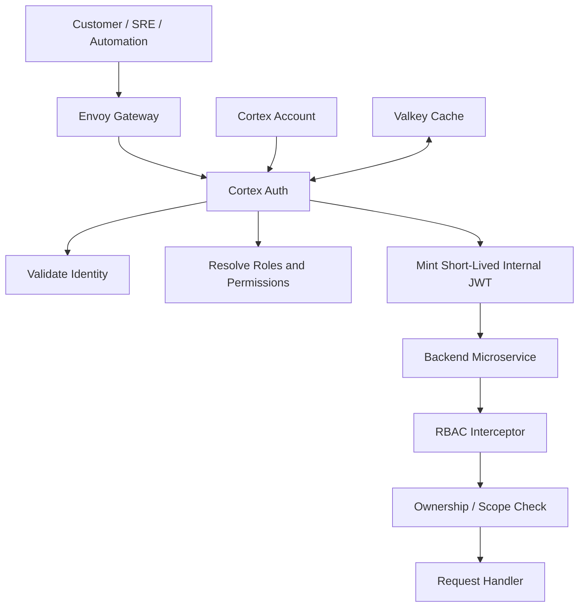
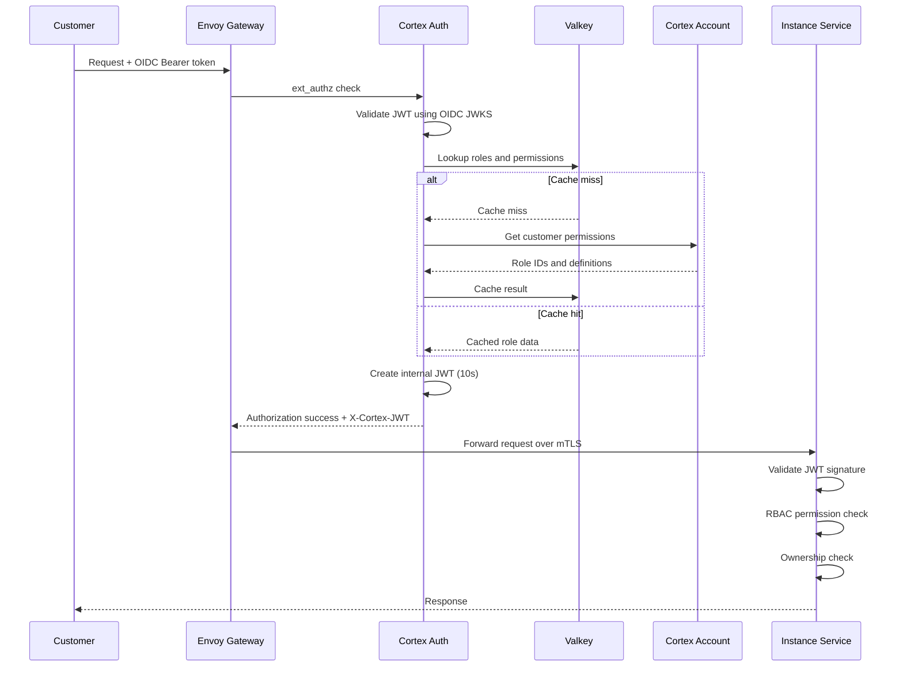
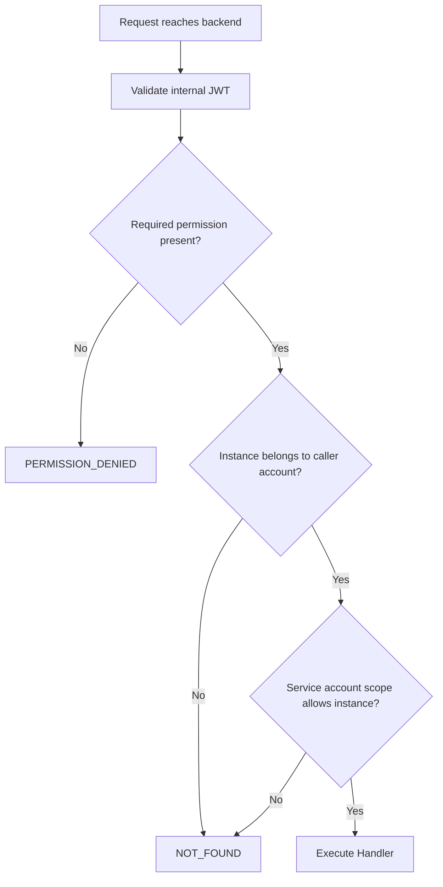
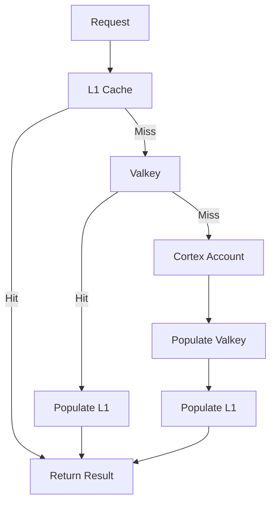
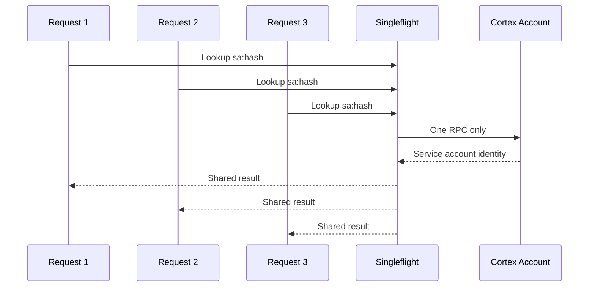
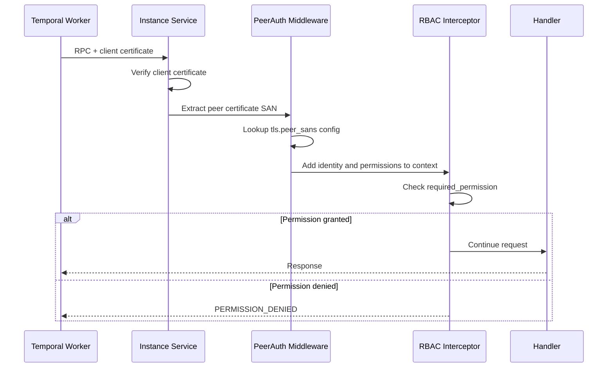
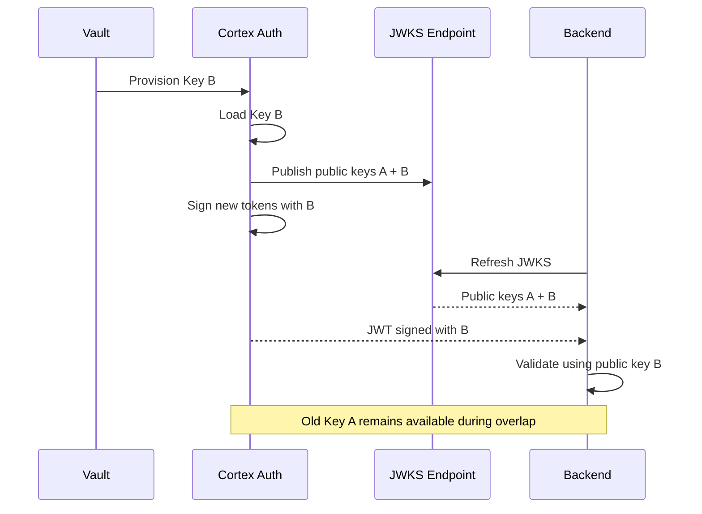

# Cortex Auth Service – Interview Preparation Guide

> A practical question-and-answer guide to understanding the Cortex Auth Service architecture, authentication flows, RBAC, caching, concurrency, security, and failure handling.

## Table of Contents

1. [Architecture Overview](#1-architecture-overview)
2. [Authentication Fundamentals](#2-authentication-fundamentals)
3. [External Request Flow](#3-external-request-flow)
4. [RBAC and Permission Checks](#4-rbac-and-permission-checks)
5. [Caching and Concurrency](#5-caching-and-concurrency)
6. [Service Accounts and Security](#6-service-accounts-and-security)
7. [Revocation and Failure Handling](#7-revocation-and-failure-handling)
8. [JWT Signing and Key Rotation](#8-jwt-signing-and-key-rotation)
9. [Additional Design Questions](#9-additional-design-questions)
10. [Self-Assessment](#10-self-assessment)

---

# 1. Architecture Overview

Before discussing individual components, understand the problem Cortex Auth solves.

Imagine a customer wants to delete a MongoDB instance.

The system needs to answer three different questions:

| Concept | Question | Example |
|---|---|---|
| Authentication | Who is making this request? | Customer, SRE, Jenkins |
| Authorization | Is the caller allowed to perform this operation? | Does the caller have `instances.delete`? |
| Ownership | Does the requested resource belong to this caller? | Does the instance belong to this account? |

These are related, but they are not the same responsibility.

## Q1. Why do we need a centralized Auth Service?

**Answer:**

In a microservice architecture, multiple services need to authenticate users and understand their permissions.

Without centralized authentication, every service might independently implement:

- JWT validation
- Service-account token validation
- Role resolution
- Permission mapping
- Identity handling

This creates duplicated code and inconsistent security behavior.

Cortex Auth centralizes external authentication and permission resolution. Backend services use a common internal JWT format and shared RBAC logic.

**Example:**

Instance Service, Backup Service and Metrics Service should not each independently contact the OIDC provider and Cortex Account to resolve the same customer's identity.

**Follow-up question:**

Does centralized authentication mean every backend request must call Cortex Auth?

**Answer:**

No. That would make Cortex Auth a runtime dependency for every request.

Instead, Cortex Auth issues a short-lived internal JWT. Backend services validate it locally using cached public keys.

## Architecture Diagram



**Important design principle:**

Cortex Auth establishes identity and resolves permissions. The backend still checks the required permission and verifies resource ownership.

---

# 2. Authentication Fundamentals

## Q2. What are the three authentication mechanisms supported by this design?

**Answer:**

The design supports three authentication mechanisms.

| Mechanism | Used By | Identity Proof |
|---|---|---|
| OIDC JWT | Customers and SREs | Identity Provider token |
| Service Account | CI/CD, scripts and automation | `crtx_` token |
| mTLS | Internal services | Client certificate |

### Example scenarios

1. Customer logs into the Cortex UI → OIDC.
2. Jenkins creates a database → Service Account.
3. Temporal worker calls Instance Service → mTLS.

An important detail: internal service-to-service calls bypass Cortex Auth.

The receiving service extracts the peer certificate SAN and resolves permissions from its local configuration.

## Q3. Why not use OIDC JWT for service-to-service communication too?

**Answer:**

OIDC is primarily designed to establish the identity of human users through an Identity Provider.

Internal services already have workload identities represented by certificates.

Using mTLS provides:

- Mutual identity verification.
- Encrypted communication.
- Certificate-based service identity.
- No need to mint or exchange another JWT for every internal service call.

**Example:**

A Temporal worker presents its certificate to Instance Service.

Instance Service identifies its SAN as:

```text
temporal-worker-psmdb
```

It then looks up the permissions configured for that identity.

---

# 3. External Request Flow

## Q4. Walk me through an authenticated customer request.

**Answer:**

Suppose a customer calls:

```http
DELETE /v1/instances/inst-123
Authorization: Bearer <OIDC_TOKEN>
```

The request follows these steps:

1. Request reaches Envoy Gateway.
2. Envoy invokes Cortex Auth through `ext_authz`.
3. Cortex Auth validates the OIDC JWT.
4. It extracts the user identity and account context.
5. It resolves customer and platform permissions.
6. It checks relevant security conditions, such as GDPR blocks.
7. It creates a 10-second Ed25519-signed internal JWT.
8. Envoy forwards the request to the backend with `X-Cortex-JWT`.
9. Backend validates the JWT and checks permissions.
10. Backend checks instance ownership and executes the handler.

## External Request Sequence Diagram



## Q5. Why does the backend validate the JWT again if Cortex Auth already validated the original token?

**Answer:**

These are two different tokens with two different purposes.

| Token | Purpose | Validated By |
|---|---|---|
| Original OIDC JWT | Proves external user's identity | Cortex Auth |
| Internal JWT | Carries trusted identity and permission claims | Backend service |

The backend validates the internal JWT's signature.

It does not need to contact the OIDC provider or revalidate the original credentials.

## Q6. Why does the internal JWT have only a 10-second expiry?

**Answer:**

The internal JWT is intended for a short request hop, not as a reusable login session.

A short expiry:

- Limits the damage if a token is leaked.
- Reduces the window in which stale permissions can be used.
- Avoids maintaining a server-side token store.
- Allows backend services to validate tokens locally.

**Follow-up question:**

Does a 10-second token guarantee that a revoked user loses access immediately?

**Answer:**

No. Token expiry limits token reuse, but revocation propagation also depends on cache invalidation, the external token's validity and the next authentication check.

---

# 4. RBAC and Permission Checks

## Q7. What is RBAC, and how is it implemented here?

**Answer:**

RBAC means Role-Based Access Control.

Instead of assigning individual permissions to every user, permissions are grouped into roles.

For example:

| Role | Permissions |
|---|---|
| Viewer | Read operations |
| Operator | Read + day-to-day operations |
| Admin | All customer permissions |

A user can have multiple roles. Their effective permissions are the union of all assigned role permissions.

The design stores readable permission names, such as `instances.delete`, and computes a bitmask for efficient checks.

## Q8. Why use a bitmask instead of comparing permission strings on every request?

**Answer:**

String-based checks are readable, but repeated string lookups and comparisons add overhead.

A bitmask represents permissions as bits in an integer array.

For example:

```text
instances.read    -> bit 0
instances.create  -> bit 1
instances.delete  -> bit 2
```

If a role has `instances.read` and `instances.delete`, its bitmask has bits 0 and 2 enabled.

The permission check becomes a bitwise operation.

### Go Example

```go
type PermissionSet []uint64

func (ps PermissionSet) Has(bit uint16) bool {
    word := bit / 64
    pos := bit % 64

    if int(word) >= len(ps) {
        return false
    }

    return ps[word]&(1<<pos) != 0
}
```

The design uses a variable-width `[]uint64`, not just one 64-bit integer. This allows more permissions to be added over time.

**Follow-up question:**

What happens if a backend sees an unknown permission during a rolling deployment?

**Answer:**

It denies the request by default.

This is called **default deny**. An unknown permission must never silently grant access.

## Q9. Why do we need both RBAC and ownership checks?

**Answer:**

RBAC answers:

> Is this caller allowed to delete instances?

Ownership answers:

> Does this particular instance belong to the caller's account?

For example, a customer may have `instances.delete`, but that does not mean they can delete another customer's instance.

The backend must check both.

For service accounts, it also checks whether the requested instance is included in the account's `instance_ids` scope.

### Authorization Decision



The design returns `NOT_FOUND` for missing, unowned or out-of-scope instances so callers cannot distinguish those cases.

---

# 5. Caching and Concurrency

## Q10. Why does Cortex Auth need multiple cache layers?

**Answer:**

Resolving roles and service-account identities repeatedly from Cortex Account would add latency and load to the account service.

The design uses three layers:

| Layer | Purpose | Typical TTL |
|---|---|---:|
| L1 | Local in-process cache | 10 seconds |
| L2 | Shared Valkey cache | 60 seconds |
| L3 | Cortex Account | Source of truth |

### Cache Lookup Flow



This is called the **cache-aside pattern**.

## Q11. What is a cache stampede? How does Singleflight prevent it?

**Answer:**

Imagine 100 requests arrive simultaneously for the same service-account token.

The token is missing from both L1 and Valkey.

Without protection, all 100 requests may call Cortex Account simultaneously.

This creates unnecessary load.

This problem is called a **cache stampede**.

The design uses Go's `singleflight.Group`.

Instead of making 100 RPC calls:

1. The first request performs the lookup.
2. Other requests wait for the same result.
3. Only one Cortex Account RPC is made for that cache key.
4. All waiting requests receive the result.

### Singleflight Sequence Diagram



**Follow-up question:**

Why use a detached context with `DoChan`?

**Answer:**

If the first request's context is cancelled, we don't want that cancellation to terminate the shared lookup for every waiting request.

A detached context with a timeout allows the shared lookup to finish independently, while still bounding its execution time.

## Q12. If Singleflight already reduces requests, why do we need a concurrency limiter?

**Answer:**

Singleflight groups requests for the **same cache key**.

But imagine 500 requests arrive for 500 different service-account tokens. They all miss the cache.

Singleflight cannot combine them because their keys differ.

A concurrency limiter protects Cortex Account from too many simultaneous RPCs.

The design uses a weighted semaphore with a default limit of 15 concurrent calls.

If the limit is reached, Cortex Auth returns `UNAVAILABLE` rather than building an unbounded queue.

### Remember the Difference

| Mechanism | Responsibility |
|---|---|
| Singleflight | Reduces duplicate work for the same key |
| Semaphore | Limits simultaneous work across different keys |

---

# 6. Service Accounts and Security

## Q13. How are service-account tokens stored and validated?

**Answer:**

A customer creates a service account for automation, such as Jenkins or a deployment script.

The design follows these steps:

1. Cortex Account creates the service account.
2. A raw token with the `crtx_` prefix is generated.
3. The raw token is returned to the customer only once.
4. The token is hashed using SHA-256.
5. The hash is used to look up the service account in Valkey or Cortex Account.
6. Expiry and revocation are checked.
7. Roles and optional instance scope are resolved.

The raw token is not stored. Only its hash is stored.

**Why?**

If the database or cache is exposed, an attacker should not immediately obtain usable service-account credentials.

Service accounts also have mandatory expiry, a maximum one-year lifetime, and can be revoked.

## Q14. How is a service account restricted to specific instances?

**Answer:**

A service account can have an optional `instance_ids` scope.

For example:

```json
{
  "sub": "sa_123",
  "act": "account_456",
  "scope": [
    "instance_1",
    "instance_2"
  ]
}
```

Cortex Auth includes this scope in the internal JWT.

The backend checks:

1. Does the instance belong to the caller's account?
2. If the service account has an explicit scope, is the requested instance in that scope?

Cortex Auth passes the scope; the backend enforces it.

## Q15. How does internal service-to-service authentication work?

**Answer:**

Consider a Temporal worker calling Instance Service.

There is no need to call Cortex Auth or mint an internal JWT.

The calling service presents its client certificate during the mTLS handshake.

The receiving service extracts the certificate's SAN and looks up the permissions configured for that identity.

### Internal Service-to-Service Sequence



**Important:**

The same RBAC permission check can be used for both external JWT callers and internal mTLS callers. The identity source is different.

---

# 7. Revocation and Failure Handling

## Q16. What happens when a service account is revoked?

**Answer:**

The design uses both active invalidation and TTL expiry.

When Cortex Account revokes a service account:

1. It publishes a Valkey `DEL` for the service-account cache key.
2. Future lookups miss the shared cache and fetch the updated state.
3. Each Auth pod has its own L1 cache, which is not directly cleared by that Valkey deletion.
4. L1 expires after 10 seconds.

There is an important trade-off here:

- If Valkey invalidation succeeds, an Auth pod may still serve its stale L1 entry for up to 10 seconds.
- If Valkey invalidation fails, stale L2 data may remain until its 60-second TTL expires, with L1 potentially adding up to another 10 seconds.

This is a **bounded-staleness trade-off**: the design accepts a small revocation delay to avoid complicated cross-replica cache invalidation.

## Q17. What happens if Valkey becomes unavailable?

**Answer:**

Cortex Auth does not immediately fail every request.

It follows a degradation strategy:

| Situation | Behavior |
|---|---|
| L1 hit | Serve from local cache |
| L1 miss, Valkey available | Check Valkey |
| L1 miss, Valkey unavailable | Call Cortex Account |
| Many simultaneous misses for same key | Singleflight deduplicates |
| Too many distinct concurrent misses | Semaphore limits concurrency |
| Semaphore full | Return `UNAVAILABLE` |

The goal is to prevent a Valkey outage from causing a cascading failure in Cortex Account.

**Follow-up question:**

Why return `UNAVAILABLE` instead of waiting indefinitely?

**Answer:**

Unbounded waiting can exhaust goroutines, connections and memory.

It is better to shed load explicitly than to overload another service and cause a larger outage.

---

# 8. JWT Signing and Key Rotation

## Q18. How do backend services trust the internal JWT?

**Answer:**

Cortex Auth signs the internal JWT using an Ed25519 private key.

Backend services receive the corresponding public key through the JWKS endpoint:

```text
/.well-known/jwks.json
```

They cache the public keys and validate JWT signatures locally.

The private key is loaded from Vault at startup. Vault is not called for every request.

## Q19. How does key rotation happen without downtime?

**Answer:**

Suppose the system currently uses Key A and needs to move to Key B.

1. Vault provisions the new key.
2. Cortex Auth loads the new key.
3. Cortex Auth starts signing new JWTs with Key B.
4. JWKS publishes both Key A and Key B public keys.
5. Backend services refresh JWKS and learn Key B.
6. Tokens signed with Key A continue to validate during the overlap.
7. After the old 10-second token lifetime has passed, the old key is no longer needed for in-flight tokens.

### Key Rotation Sequence



**Follow-up question:**

What if the JWKS endpoint is temporarily unavailable?

**Answer:**

Backends continue using their cached public keys.

This is why key caching is important.

The design also makes the initial JWKS fetch a readiness requirement, so a backend does not start accepting traffic without valid verification keys.

---

# 9. Additional Design Questions

## Q20. Why does the Auth Service not own a PostgreSQL database?

**Answer:**

Cortex Account is the source of truth for accounts, team members, service accounts and roles.

Cortex Auth is responsible for:

- Validating credentials.
- Resolving identity and permissions.
- Issuing internal JWTs.

Keeping the Auth Service stateless means:

- It can scale horizontally.
- Replicas do not need local database synchronization.
- There is no separate customer-data ownership.
- A failed Auth pod can be replaced without recovering local state.

It still uses local and shared caches, but those caches are not the source of truth.

## Q21. Why do we need rate limiting if we already have authentication?

**Answer:**

Authentication verifies who is calling.

It does not guarantee that the caller is making a reasonable number of requests.

A valid but compromised service-account token could generate thousands of requests.

The design therefore uses rate limits at Envoy.

| Caller | Default Limit |
|---|---:|
| Per customer account | 100 requests/sec |
| Per service account | 50 requests/sec |
| Public endpoints, per source IP | 10 requests/sec |
| Internal caller, per certificate SAN | 200 requests/sec |

Rate limiting protects capacity; circuit breakers provide an additional protection against overloaded upstream services.

---

# 10. Self-Assessment

Try answering these questions before expanding the answers.

<details>
<summary><strong>Q1. 100 requests arrive simultaneously for the same service-account token. Both L1 and Valkey have a cache miss. What prevents 100 calls to Cortex Account?</strong></summary>

**Answer: Singleflight**

Singleflight collapses concurrent misses for the same cache key into one Cortex Account RPC. The other requests share the result.
</details>

<details>
<summary><strong>Q2. 500 requests arrive for 500 different cache keys. What limits concurrent calls to Cortex Account?</strong></summary>

**Answer: Semaphore**

Singleflight only deduplicates requests with the same key. The semaphore limits concurrent RPCs across distinct keys.
</details>

<details>
<summary><strong>Q3. A Temporal worker calls Instance Service over mTLS. Does it need Cortex Auth to mint an internal JWT?</strong></summary>

**Answer: No.**

The receiving service uses the peer certificate SAN and local `tls.peer_sans` configuration to establish identity and permissions.
</details>

<details>
<summary><strong>Q4. A customer has instances.delete permission but requests deletion of another customer's instance. What should happen?</strong></summary>

**Answer: The backend ownership check should deny it.**

RBAC checks the action permission. The backend separately checks account ownership and, for service accounts, instance scope.
</details>

<details>
<summary><strong>Q5. Valkey is unavailable, but an Auth pod has the service account in its L1 cache. Can it serve the request?</strong></summary>

**Answer: Yes, subject to the cached entry's validity.**

The L1 cache can absorb requests during a Valkey outage. When L1 misses, Cortex Auth falls back to Cortex Account, protected by Singleflight and the concurrency limiter.
</details>

<details>
<summary><strong>Q6. Why do we need both Singleflight and a semaphore?</strong></summary>

**Answer: They solve different problems.**

- Singleflight reduces duplicate lookups for the same key.
- Semaphore limits simultaneous lookups across different keys.
</details>

<details>
<summary><strong>Q7. Does a 10-second internal JWT expiry guarantee immediate revocation?</strong></summary>

**Answer: No.**

Revocation also depends on cache invalidation and the next authentication check. A short-lived token limits the reuse window but does not eliminate stale cache entries.
</details>

---

# Suggested Learning Sequence

Don't try to memorize all the answers at once. Learn them in this order.

| Session | Topics | Expected Understanding |
|---|---|---|
| 1 | Q1–Q6 | Overall architecture and external request flow |
| 2 | Q7–Q9 | RBAC, bitmasks and ownership |
| 3 | Q10–Q12 | Caching, Singleflight and concurrency |
| 4 | Q13–Q15 | Service accounts and mTLS |
| 5 | Q16–Q17 | Revocation and failure handling |
| 6 | Q18–Q21 | Key rotation, statelessness and rate limiting |

## Most Important Questions for Senior-Level Interviews

Focus especially on these questions:

1. How does the complete external authentication flow work?
2. Why do we need both RBAC and ownership checks?
3. How does Singleflight prevent cache stampedes?
4. Why is a semaphore needed when Singleflight already exists?
5. What happens when a service account is revoked?
6. How does the system behave when Valkey becomes unavailable?
7. How does internal service-to-service authentication work without Cortex Auth?

**Interview tip:** Don't just explain what a component does. Explain why it exists, what problem it solves, what happens when it fails, and what trade-off the design accepts.
